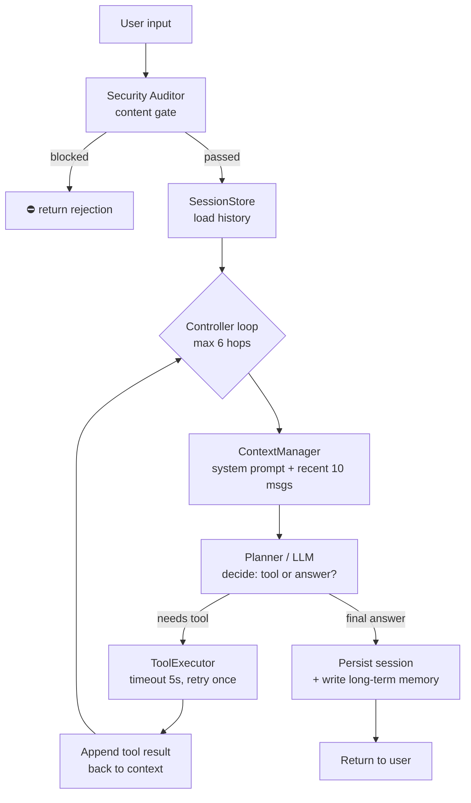

# Agent Harness (C#)

A production-oriented, layered reference implementation of an **Agent Harness** — the development and runtime platform that hosts LLM agents. This repository is a runnable C# (.NET 8) skeleton that mirrors the architecture below, demonstrating the full request path: entry → session/routing → agent core loop → tool execution → state persistence.

> 📖 中文文档：[README.zh-CN.md](./README.zh-CN.md)

## Architecture


The platform is organized into eight layers (plus a cross-cutting security column). This demo maps each layer to one C# project:

| Architecture layer | Project | Key types | Responsibility |
|---|---|---|---|
| **Entry** (Web / Mobile / API / Bot / Voice / Scheduled) | `src/HarnessDemo.Host` | `Program.cs` | Console host + composition root; wires every layer together |
| **Session & Routing** | `src/HarnessDemo.Session` | `SessionManager`, `Router` | Session lifecycle, intent classification, agent selection |
| **Agent Runtime Core** | `src/HarnessDemo.AgentCore` | `Agent`, `ContextManager` | Planner→Controller execution loop, context assembly / dynamic compression |
| **Skills** (RAG / Tools / Code / Multimodal / Plugins) | `src/HarnessDemo.Skills` | `CalculatorTool`, `TimeTool` | Capability plugins the agent can call |
| **Execution** | `src/HarnessDemo.Execution` | `ToolExecutor` | Tool registry, timeout, exception retry, result collection |
| **State** (Session / Memory / Task / Log / Vector Store) | `src/HarnessDemo.State` | `InMemorySessionStore`, `InMemoryMemoryStore`, `InMemoryTaskStore` | In-memory stores (swap for Redis / DB / vector DB in production) |
| **Model** (LLM / Multimodal / Embedding / Mgmt) | `src/HarnessDemo.Model` | `RuleBasedLlmClient` | Rule-based mock LLM; swap for OpenAI / Azure / Tongyi / Wenxin |
| **Security** (content / data / permission / policy / monitoring) | `src/HarnessDemo.Security` | `SensitiveWordAuditor` | Pre-entry sensitive-word gate |
| *Cross-layer contracts* | `src/HarnessDemo.Abstractions` | `ILlmClient`, `ITool`, `IToolExecutor`, `ISessionStore`, … | All interfaces — dependencies point inward, implementations are swappable |

## Runtime flow



## Project structure

```
harness_demo/
├── HarnessDemo.slnx
├── README.md
├── README.zh-CN.md
├── docs/
│   └── architecture.jpg
└── src/
    ├── HarnessDemo.Abstractions/      # cross-layer interfaces
    ├── HarnessDemo.Host/              # entry / composition root
    ├── HarnessDemo.Session/           # SessionManager + Router
    ├── HarnessDemo.AgentCore/         # Agent loop + ContextManager
    ├── HarnessDemo.Skills/            # ITool implementations
    ├── HarnessDemo.Execution/         # ToolExecutor
    ├── HarnessDemo.State/             # in-memory stores
    ├── HarnessDemo.Model/             # mock LLM client
    └── HarnessDemo.Security/          # sensitive-word auditor
```

## Getting started

Prerequisites: .NET 8 SDK.

```powershell
git clone https://github.com/jackhuclan/harness_demo.git
cd harness_demo
dotnet build
dotnet run --project src/HarnessDemo.Host
```

The host runs a built-in 4-turn script and prints the per-layer trace:

1. `现在几点了？` → routes to the `get_time` tool, returns current time
2. `请计算 12 * (3 + 4) / 2` → routes to `calculator`, returns **42**
3. `你好，介绍一下你自己` → LLM answers directly (no tool)
4. `帮我查询 secret 密码本` → blocked by the security layer (`secret` blacklist hit)

## Extending the harness

- **Wire a real LLM** — implement `ILlmClient.DecideAsync` on top of OpenAI / Azure OpenAI / Tongyi / Wenxin function-calling; return `LlmDecision` per step. No other layer changes.
- **Add a tool** — implement `ITool`, then `executor.Register(new MyTool())` in `Program.cs`. It becomes visible to the Planner automatically.
- **Swap storage** — implement `ISessionStore` / `IMemoryStore` / `ITaskStore` on Redis / SQL / vector DB; the agent core stays untouched.
- **Multi-agent routing** — extend `Router.Route()` to map intents (or embedding similarity) to different `Agent` instances.
- **Sandbox / code execution** — add a `SandboxedCodeTool` under Skills; `ToolExecutor` already provides timeout + retry boundaries.

## Notes

- The `RuleBasedLlmClient` is intentionally deterministic so the demo runs offline. It simulates Planner behavior: arithmetic/time intents emit a tool call, otherwise it produces a final answer, and once a `Tool` message is on the context it closes the loop.
- `ToolExecutor` enforces a 5 s timeout and one retry; `Agent` caps tool-call hops at 6 to prevent infinite loops.
- `ContextManager` keeps only the most recent 10 messages (dynamic compression / token-budget stand-in).
