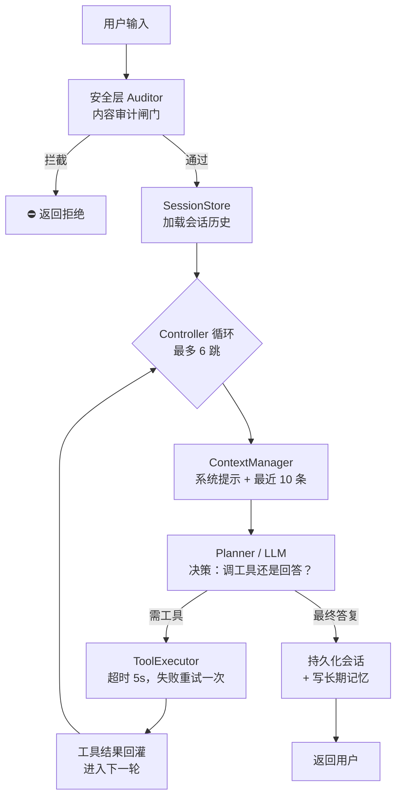

# Agent Harness（C# 实现）

[](https://github.com/jackhuclan/harness_demo/actions/workflows/ci.yml)
[](https://github.com/jackhuclan/harness_demo/blob/main/LICENSE)

面向生产的 **Agent Harness（智能体运行保障平台）** 分层参考实现。本仓库是一个可运行的 C#（.NET 8）骨架，严格对应下方架构图，演示智能体从「入口 → 会话路由 → 核心引擎循环 → 工具执行 → 状态持久化」的完整链路。

> 📖 English: [README.md](./README.md)

## 架构总览


平台分为八个分层（外加贯穿全局的安全层）。本 Demo 把每个分层映射为一个 C# 项目：

| 架构图层 | 项目 | 关键类 | 职责 |
|---|---|---|---|
| **入口层**（Web / Mobile / API / Bot / Voice / Scheduled） | `src/HarnessDemo.Host` | `Program.cs` | ASP.NET Core Minimal API 宿主，监听 `http://localhost:5000`；用内置 DI 装配所有分层 |
| **会话与路由层** | `src/HarnessDemo.Session` | `SessionManager`、`Router` | 会话生命周期、意图识别、Agent 选择 |
| **Agent Runtime Core** | `src/HarnessDemo.AgentCore` | `Agent`、`ContextManager` | Planner→Controller 执行循环、上下文组装 / 动态压缩 |
| **能力层 Skills**（RAG / Tools / Code / Multimodal / Plugins） | `src/HarnessDemo.Skills` | `CalculatorTool`、`TimeTool` | 智能体可调用的能力插件 |
| **执行层 Execution** | `src/HarnessDemo.Execution` | `ToolExecutor` | 工具注册表、超时控制、异常重试、结果收集 |
| **状态层 State**（Session / Memory / Task / Log / Vector Store） | `src/HarnessDemo.State` | `InMemorySessionStore`、`InMemoryMemoryStore`、`InMemoryTaskStore` | 内存版存储（生产可换 Redis / 数据库 / 向量库） |
| **模型层 Model**（LLM / 多模态 / 嵌入 / 模型管理） | `src/HarnessDemo.Model` | `RuleBasedLlmClient` | 规则模拟 LLM，可换 OpenAI / Azure / 通义 / 文心 |
| **安全层 Security**（内容 / 数据 / 权限 / 策略 / 监控） | `src/HarnessDemo.Security` | `SensitiveWordAuditor` | 入口前置敏感词闸门 |
| *跨层契约* | `src/HarnessDemo.Abstractions` | `ILlmClient`、`ITool`、`IToolExecutor`、`ISessionStore`… | 全部接口——依赖向内指向，实现可替换 |

## 运行时链路



## 目录结构

```
harness_demo/
├── HarnessDemo.slnx
├── README.md
├── README.zh-CN.md
├── docs/
│   └── architecture.jpg
└── src/
    ├── HarnessDemo.Abstractions/      # 跨层接口契约
    ├── HarnessDemo.Host/              # 入口 / 组装根
    ├── HarnessDemo.Session/           # SessionManager + Router
    ├── HarnessDemo.AgentCore/         # Agent 执行循环 + ContextManager
    ├── HarnessDemo.Skills/            # ITool 能力插件
    ├── HarnessDemo.Execution/         # ToolExecutor 工具执行器
    ├── HarnessDemo.State/             # 内存版状态存储
    ├── HarnessDemo.Model/             # 模拟 LLM 客户端
    └── HarnessDemo.Security/         # 敏感词审计
```

## 快速开始

前置要求：.NET 8 SDK。

```powershell
git clone https://github.com/jackhuclan/harness_demo.git
cd harness_demo
dotnet run --project src/HarnessDemo.Host
```

API 监听 `http://localhost:5000`，端点如下：

| 方法 | 路径 | 用途 |
|---|---|---|
| `GET` | `/` | 服务发现 / 健康检查 |
| `GET` | `/tools` | 查看已挂载的能力插件 |
| `POST` | `/chat` | 发送一轮对话，body 为 `{"sessionId":"...","message":"..."}` |
| `GET` | `/sessions/{sessionId}` | 读取会话历史（状态层只读视图） |

调用示例：

```powershell
# 时间工具
curl -X POST http://localhost:5000/chat -H "Content-Type: application/json" `
  -d '{"sessionId":"sess-001","message":"现在几点了？"}'

# 计算工具 -> 42
curl -X POST http://localhost:5000/chat -H "Content-Type: application/json" `
  -d '{"sessionId":"sess-001","message":"请计算 12 * (3 + 4) / 2"}'

# 被安全层拦截（命中 "secret" 黑名单）
curl -X POST http://localhost:5000/chat -H "Content-Type: application/json" `
  -d '{"sessionId":"sess-001","message":"帮我查询 secret 密码本"}'
```

同一个 `sessionId` 会保留多轮上下文（由 `SessionStore` 维护）。

## 配置（`.env`）

把 `.env.example` 复制为 `.env` 并填入你的大模型端点（该文件已被 gitignore，请勿提交真实密钥）：

```env
LLM_ENDPOINT=http://your-local-llm-host/v1
LLM_API_KEY=sk-your-key
LLM_MODEL=your-model-name
LLM_MAX_TOKENS=4096
USE_REAL_LLM=true        # false -> 内置规则模拟（离线演示）
```

Host 启动时通过 `DotNetEnv` 读取 `.env`。`USE_REAL_LLM=true` 时装配真实 OpenAI 兼容客户端（`OpenAiLlmClient`，基于 OpenAI SDK v2.x）；`false` 时回退到离线的 `RuleBasedLlmClient`。可对接任何 OpenAI 兼容端点（本地 vLLM / Ollama / OpenAI / Azure / 通义 / 文心）。

| 包 | 用途 |
|---|---|
| `OpenAI` 2.14.0 | 调本地端点的 chat completions + function calling |
| `DotNetEnv` 3.2.0 | 启动时读取 `.env` |

## 扩展方式

- **接真实大模型** —— 实现 `ILlmClient.DecideAsync`，内部调用 OpenAI / Azure OpenAI / 通义 / 文心的 function calling，每步返回 `LlmDecision`，其他层无需改动。
- **加工具** —— 实现 `ITool`，在 `Program.cs` 里 `executor.Register(new MyTool())`，Planner 自动可见。
- **换存储** —— 实现 `ISessionStore` / `IMemoryStore` / `ITaskStore`，背后接 Redis / SQL / 向量库，Agent Core 不动。
- **多 Agent 路由** —— 扩展 `Router.Route()`，按意图（或 embedding 相似度）分发到不同 `Agent` 实例。
- **沙箱代码执行** —— 在 Skills 下新增 `SandboxedCodeTool`；`ToolExecutor` 已经提供超时 + 重试边界。

## 说明

- `RuleBasedLlmClient` 刻意做成确定性规则引擎，让 Demo 完全离线可跑。它模拟 Planner 行为：算术 / 时间意图发出工具调用，其余直接给最终答复；一旦上下文里出现 `Tool` 消息就闭环收尾。
- `ToolExecutor` 强制 5 秒超时并失败重试一次；`Agent` 把工具调用跳数上限设为 6，防止死循环。
- `ContextManager` 只保留最近 10 条消息（动态压缩 / Token 预算的简化实现）。
